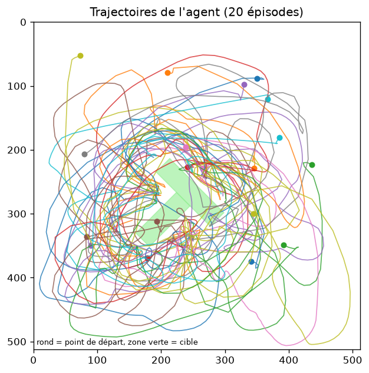
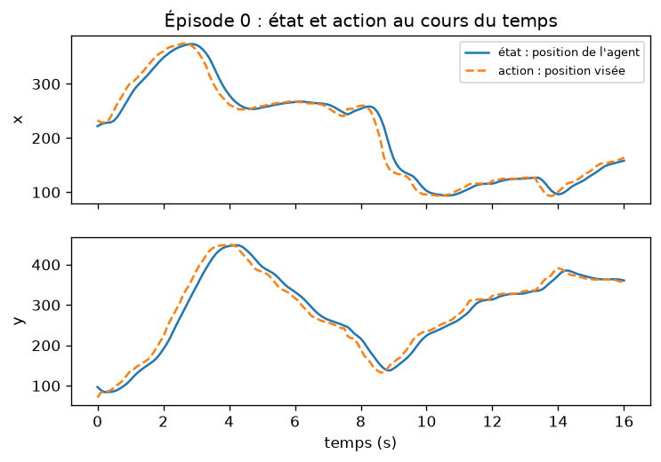
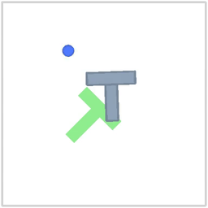
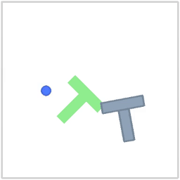
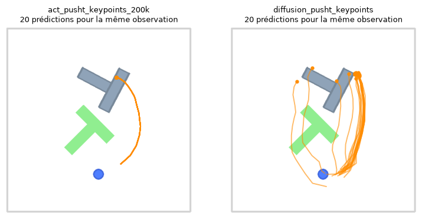
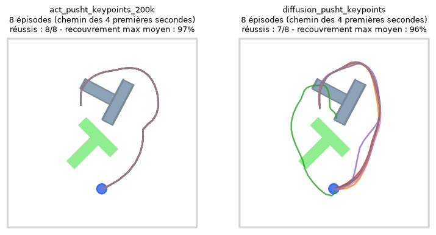

# Rapport de TP – Apprentissage par imitation avec LeRobot

**Nom, prénom :** RADANOVIC GOMES, Lucia 

**Système d'exploitation et processeur :** Windows 11, Intel Core i5 

**Durée de l'entraînement de la partie 3 sur votre machine :** ... minutes

<!--
Ceci est un commentaire Markdown : il n'apparaît pas quand GitHub affiche le fichier.

PETIT AIDE-MÉMOIRE MARKDOWN
- Titres :            # Titre 1   ## Titre 2   ### Titre 3
- Gras, italique :    **gras**   *italique*
- Liste à puces :     une ligne commençant par "- "
- Liste numérotée :   une ligne commençant par "1. "
- Lien :              [texte du lien](https://adresse.fr)
- Image :             
                      (le chemin est relatif au dossier rapport/, où se trouve ce fichier)
- Code dans le texte : `lerobot-train`
- Bloc de code :      trois accents graves ``` avant et après le bloc
- Formule :           $\text{époques} = \frac{\text{itérations} \times \text{lot}}{\text{nombre de pas de temps}}$
- Tableau :
                      | Colonne 1 | Colonne 2 |
                      |---|---|
                      | a | b |
- Citation :          une ligne commençant par "> "
- Paragraphe :        laissez une ligne vide entre deux paragraphes

Pour voir le rendu avant d'envoyer : dans VS Code, ouvrez ce fichier puis Ctrl+Maj+V (Cmd+Maj+V sur Mac).
-->

## Partie 1 – Découvrir la tâche et les démonstrations

### Q1

La dataset contient 206 épisodes, et 25 650 pas de temps au total. La durée moyenne d'une démonstration est de 12.5 secondes.



### Q2

L'action est en avance par raaport à l'état. Cela est logique car l'action est la position visée par l'agent à ce pas de temps, c'est-à-dire la position indiquée par l'utilisateur dans le cas d'une démonstration, et l'état est la vraie position de l'agent. Ainsi, l'état "suit" l'action et, comme il ne peut pas être instantané, on repère un certain retard de ce premier.

### Q3

**En le voyant comme un problème d'apprentissage supervisé:**
- l'entrée du réseau est la position initiale du T
- la sortie attendue est la position de la cible 
- les exemples viennent du dataset ```lerobot/pusht_keypoints```

### Q4

Les positions de départ ne couvrent pas le contour de la scène: le T ne se rapproche jamais des frontières externes de l'espace 2D représenté. Elles semblent équitablement distribuées dans un carré de côté inférieur à la scène entière, centralisé (dans l'escale de 0 à 500 dessinée, les coins du T semblent éviter les 50 unités les plus proches du périmètre externe). 

## Partie 2 – Enregistrer ses propres démonstrations

### Q5

|  | Dataset de référence | Mes démonstrations |
| --- | --- | --- |
| Nombre d'épisodes | 206 | 20 |
| Nombre total de pas de temps | 25650 | 3626 |
| Durée totale des démonstrations (s) | 2565 | 362,6 |
| Durée moyenne (s) | 12.5 | 18.1 |
| Durée minimale (s) | 4.9 | 8.8 |
| Durée maximale (s) | 24.6 | 27.5 |
| Distance moyenne entre l'action et la position de l'agent (unités) | 23.3 | 24.6 |


Mes démonstrations ont une durée moyenne supérieure au dataset de référence, ainsi que des trajectoires plus bruitées: on remarque un grand nombre de lignes et allers-retours proches de la cible, pour les derniers ajustements, bien supérieur à la figure de référence (qui ne contient que la trajectoire de 20 épisodes pour être comparable). Ainsi, on pourrait en déduire que mes démonstrations sont de qualité inférieure pour l'entraînement du modèle.

### Q6

L'enregistrement de 20 démonstrations a pris environ 8 min 45 secondes (chronométrées), avec 2 tentatives ratées, soit un taux de 10%. On peut en conclure que, pour un vrai robot, qui demanderait des centaines de démonstrations, le coût serait assez elevé: des heures de démonstrations à enregistrer.

## Partie 3 – Entraîner et évaluer une politique ACT

### Q7

Avec 20 démonstrations, mon dataset contient 3626 pas de temps. 
Si on a un batch size de 64 et 5000 steps, le réseau a vu $64*5000 = 320 000$ exemples. 

$320 000 / 3626 \approx 88,25$. Donc chaque exemple sera visité environ 88,25 fois, soit 88,25 epochs.

À la fin de l'entraînement, le terminal m'indique bien 88,25 epochs.

### Q8

La politique fait une prédiction toutes les secondes (10 actions).

L'avantage de réaliser plusieurs actions "les yeux fermés" est qu'on évite une surcorrection de chaque action singulière, qui entraînerait une trajectoire bruitée; de plus, on économise des coûts de calcul à chaque action. Toutefois, l'inconvénient est que la trajectoire peut s'éloigner de la cible sans correction, ce qui demandera par la suite plus de correction et de temps pour atteindre la cible.

### Q9

| Itération | `loss` | `l1_loss` | `kld_loss` |
|---|---|---|---|
| 200 | 2,693 | 0,420 | 0,005 |
| 600 | 0,314 | 0,294 | 0,002 |
| 1000 | 0,269 | 0,261 | 0,001 |
| 2000 | 0,225 | 0,223 | 0,000 |
| 3400 | 0,196 | 0,195 | 0,000 |
| 5000 | 0,176 | 0,175 | 0,000 |

```l1_loss``` et ```kld_loss``` connaissent toutes les deux une décroissance exponentielle, pour se rapprocher de la valeur limite de 0.

Une perte très faible ne signifie pas que la politique réussit la tâche, mais seulement qu'elle s'y rapproche.

```kld_loss``` mesure à quel point la variable latente s'écarte d'une loi normale. Ainsi, si elle se rapproche de 0, cela indique que la variable latente se rapproche et finit par se confondre avec une loi normale. 

### Q10

Le taux de réussite de ma politique est de de 2%, et le score moyen est de 0,243, soit un recouvrement maximal d'environ 23,1% de l'aire ciblée.





La politique semble imiter ma manière d'agir: des mouvements plus rapides lorsqu'on est loin de la cible, puis plus délicats lorsqu'on se rapproche, pour les dernières corrections. De plus, lorsqu'on est proches de la cible, il s'éloigne vite de l'objet pour en faire le tour, pour éviter de le taper par accident (même si ne n'est pas toujours réussi vu le deuxième exemple).

### Q11 (facultatif)

En évaluant le checkpoint 1000 (c'est-à-dire, un modèle entraîne sur 1000 itérations, et non 5000), on a un taux de réussite de 0% et un score moyen de 0.166, soit environ 15,7% de recouverement maximal de l'aire ciblée.

On peut donc en affirmer que le modèle s'améliore entre 1000 et 5000 itérations, puisque autant sont taux de réussite que son score moyen augmentent de manière significative.

## Partie 4 – Les limites de l'apprentissage par imitation

### Q12

| Évaluation | Nombre d'épisodes | Taux de réussite | Recouvrement ≥ 80 % | Score moyen |
|---|---|---|---|---|
| act_pusht_10demos | 50 | 2 % | 2 % | 21 % |
| act_pusht_20demos | 50 | 0 % | 8 % | 24 % |
| act_pusht_50demos | 50 | 0 % | 12 % | 38 % |
| act_pusht_206demos | 50 | 2 % | 14 % | 42 % |
| act_pusht_206demos_long | 50 | 6 % | 72 % | 79 % |
| act_mes_demos | 50 | 2 % | 12 % | 24 % |
| act_mes_demos_1000 | 50 | 0 % | 4 % | 17 % |

> *NB: ```act_mes_demos_1000``` est le modèle entraîné sur 1000 itérations sur mes démonstrations.*

#### Évolution en fonction du nombre de démonstrations

> *Pour pouvoir comparer, on n'observe que les modèles entraînés sur un même nombre d'itérations, soit ```act_pusht_10demos```, ```act_pusht_20demos```, ``` act_pusht_50demos```, ```act_pusht_206demos``` et ```act_mes_demos```.*

Le taux de recouvrement $\geq$ 80% et le score moyen augmentent lorsque le nombre de demos augmente. 

Quant au taux de réussite, il ne prend que 2 valeurs pour les modèles entraînés sur 5000 itérations: 0 ou 2%. Comme il part d'une valeur plus élevée (pour 10 demos), diminue puis réaugmente pour 206 demos, on ne peut pas en conclure grand chose dessus sans plus de données. 

#### Évolution en fonction de la durée d'entraînement

> *Maintenant, on compare ```act_pusht_206demos``` et ```act_pusht_206demos_long```.*

On remarque une grande amélioration du taux de recouvrement $\geq$ 80%, qui est multiplié par 5 entre le modèle à 5000 et à 30 000 itérations. Le taux de réussite et le score moyen sont aussi largement meilleurs pour ce deuxième modèle, avec une multiplication par 3 et presqu'un doublage, respectivement.


Toutefois, même le meilleur modèle montre un taux de réussite assez faible (seulement 6%). Il faudrait peut-être modifier la technique d'entraînement du modèle: l'imitation ne semble pas suffisante pour cette tâche. En effet, elle a certaines limitations: elle ne montre pas ce qui ne doit pas être fait, et ne recouvre pas toutes les situations possibles.
### Q13

Mon modèle est meilleur que le modèle entraîné sur le dataset de référence pour 20 demos: en effet, les deux ont le même socre moyen, et le mien a des taux de recouvrement $\geq$ 80% et de réussite supérieurs.

Je peux supposer que cela vient de la stratégie, qui impacte la durée des démonstrations et la régulartié des gestes: j'essayais d'effectuer une rotation depuis le début, pour me rapprocher de l'orientation finale de l'objet, et d'arriver vite vers une position assez proche, où je pouvais par la suite régler les détails. D'après l'image des trajectoires du dataset, il me semble que ces derniers ajustements n'étaient pas les plus communs, l'agent ne se rapproche pas de la cible autant de fois.

### Q14

Si je devais enregistrer 20 démonstrations supplémentaires, je privilègierai des départs du T plus vers le haut de l'espace. 

### Q15

J'ai perturbé le modèle des manières suivantes:
- **déplacé l'agent du côté opposé du T**: la politique repasse du "bon" côté rapidement, ou trouve un autre angle pour rapprocher le T de la cible
- **déplacé le T vers les frontières externes de la scène**: la politique a du mal a se rattraper, sauf si rapidement le T revient à une position plus centrale
- **effectué une rotation du T**: la politique repère la nouvelle orientation et effectue une nouvelle rotation pour bien orienter le T

J'en déduis que ce modèle est assez robuste, à l'exception de lorsqu'on enlève le centre du T de la zone exploité (comme vu dans la carte de chaleur).  

### Q16

On remarque ici le même phénomène que j'ai décrit à la question précédente: si à l'état initial le centre du T se retrouve en dehors des zones visitées, la politique se retrouve perdue, sans savoir quoi faire. 

C'est une limite de l'apprentissage par imitation: on ne peut pas explorer toutes les situations possibles, et, en dehors des situations rencontrées, la politique sera mal entraînée.

## Partie 5 – Une autre famille de politiques : Diffusion Policy

### Q17

| Évaluation | Nombre d'épisodes | Taux de réussite | Recouvrement ≥ 80 % | Score moyen |
|---|---|---|---|---|
| act_pusht_keypoints_200k | 50 | 62 % | 88 % | 88 % |
| diffusion_pusht_keypoints | 50 | 84 % | 98 % | 98 % |

Pour l'ACT, réaliser un chunk d'actions ne demande qu'une seule évaluation du réseau, alors que la Diffusion Policy en demande 10. Ainsi, pour la commande en temps réel d'un robot, l'ACT est préférable car la prédiction sera réalisée plus rapidement, et introduira moins de latence dans la commande.

### Q18



Pour l'ACT, on remarque 1 seule trajectoire qui rejoint le T, alors que pour la Diffusion Policy il y en a plusieurs. 

Cela se passe puisque, dans le modèle ACT, une fois la politique entraînée, le modèle renvoie $Â = f_\theta(o,0)$, le résultat de l'encodeur pour $z=0$. Cette politique est donc déterministe: pour une observation $o$ donnée, elle renvoie toujours la même action $Â$.

En revanche, la Diffusion Policy part d'un bruit $A^K$ tiré au hasard dans une loi normale  $\mathcal{N}(0, I)$, qu'on débruite alors grâce au réseau $\varepsilon_\theta(A^k,k,o)$. Ce tirage au sort induit des conditions initales différentes, qui ont ensuite un impact sur la prédiction réalisée.

### Q19

On
 
- Les modes le plus à gauche (2 trajectoires à gauche), touchant la base du T, ne représentent pas des stratégies admissibles pour amener le T sur la cible: en effet, ils semblent l'éloigner encore plus. 
- Il est difficile à dire si le mode du milieu réalise une trajectoire qui accomplira la tâche: il semble que celui-ci peut éloigner le T, mais il semble se corriger assez vite, et réaliser des actions cohérentes avec son but. 
- Les modes les plus à droite représentent des stratégies qui amènereont certainement le T à la cible, avec celui le plus à droite, qui touche le coin du T (avec le plus de prédictions) le plus optimal.

La prédiction d'ACT semble suivre le 4e mode: il touche la partie supérieure du T, mais vers le coin gauche supérieur, pour en réaliser la rotation. 
### Q20


<!-- Les formules s'écrivent entre $...$ (dans le texte) ou entre $$...$$ (sur une ligne à part), en LaTeX. -->

1. 

2. 

3. 

### Q21



### Q22 – Conclusion
